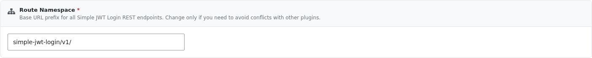
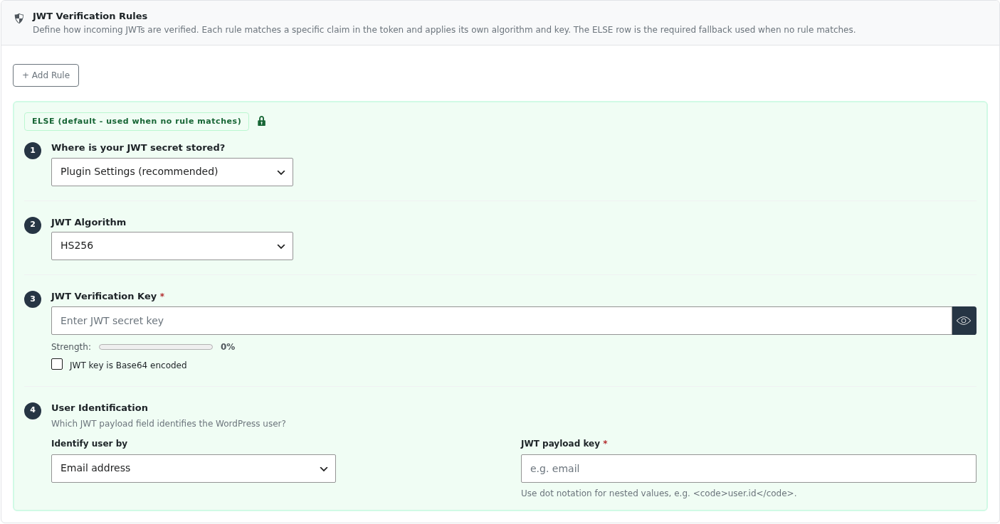
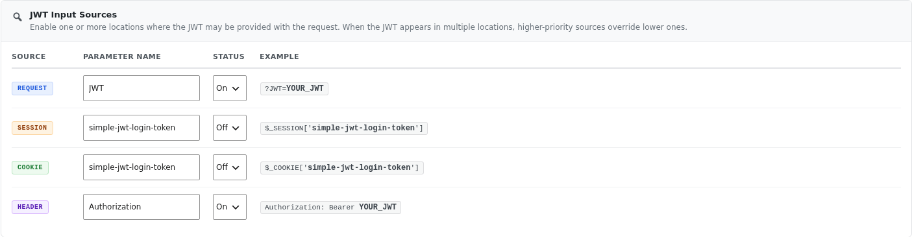
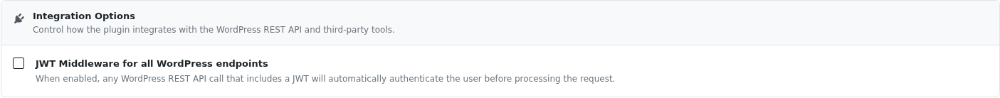
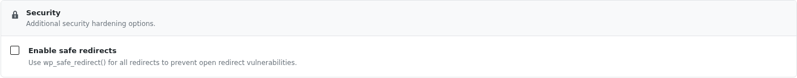

The **General** settings page is the foundation of Simple JWT Login. It controls the API route prefix, how JWTs are signed and verified, where the plugin looks for tokens in incoming requests, and global security options.

Go to **Settings → Simple JWT Login → General** to configure these options.

---

## Server

The Simple-JWT-Login REST API is accessible via two URL formats. Both are equivalent - choose the one that fits your WordPress permalink configuration:

- **Pretty permalinks** (recommended):
  ```
  https://{domain}/wp-json/simple-jwt-login/v1/{endpoint}
  ```
- **Query-string format** (works even without pretty permalinks):
  ```
  https://{domain}/?rest_route=/simple-jwt-login/v1/{endpoint}
  ```

## Request Parameters

Parameters can be sent in any of the following ways:

- **JSON request body** (recommended for POST/PUT/DELETE requests)
- **Query string** (convenient for GET requests and quick testing)
- **Form data** (`application/x-www-form-urlencoded`)

The `JWT` parameter name is case-insensitive - `jwt`, `JWT`, and `Jwt` are all accepted.

## Initial Configuration

1. Go to **Settings → Simple JWT Login → General**.
2. Set a **JWT secret key** and choose a **signing algorithm** in the **JWT Verification Rules** ELSE row (the required default rule). See [JWT Verification Rules](#jwt-verification-rules) below.
3. Click **Save Changes**.

:::caution
Use a long, random string for the JWT secret key. This key is equivalent to a master password - anyone who knows it can forge valid tokens.
:::

---

## Route Namespace



The **Route Namespace** is the URL prefix for all Simple JWT Login REST endpoints. The default is `simple-jwt-login/v1/`.

Change this only if you need to avoid a conflict with another plugin. The value is trimmed of leading and trailing slashes automatically.

```
https://example.com/wp-json/simple-jwt-login/v1/auth
                             ^^^^^^^^^^^^^^^^^^^
                             route namespace
```

:::caution
If you change the route namespace after you have already issued JWTs, any existing links that embed the old endpoint URL (for example, autologin links in emails) stop working.
:::

---

## JWT Verification Rules



JWT Verification Rules let you use **different signing algorithms and keys** for different tokens - chosen dynamically based on a claim inside the token itself. This is useful when:

- You accept JWTs from multiple identity providers (Auth0, Google, your own service)
- Different clients were issued tokens under different algorithms
- You want to migrate keys without forcing all users to re-authenticate at once

The rules are evaluated in order. The first rule whose condition matches is used; if none matches, the **ELSE** (default) rule is used.

### How a rule works

Each rule has three parts:

**IF** - a condition that inspects a claim in the incoming JWT

| Field | Options | Description |
| :---- | :------ | :---------- |
| JWT Part | `Payload claim` / `Header claim` | Which part of the JWT to inspect |
| Claim Key | text | The key to look up (for example, `iss`, `alg`, `x-provider`) |
| Operator | `equals` / `contains` | Comparison to apply |
| Expected Value | text | The value the claim must match |

**THEN USE** - the algorithm and key to apply when the condition matches

| Field | Description |
| :---- | :---------- |
| Algorithm | `HS256`, `HS384`, `HS512`, `RS256`, `RS384`, `RS512` |
| Secret Key (HS*) | Symmetric secret; optionally Base64-encoded |
| Public / Private Key (RS*) | PEM-encoded RSA key pair |

**IDENTIFY** - how to look up the WordPress user from the token payload

| Field | Options |
| :---- | :------ |
| Identify user by | `Email address` / `WordPress User ID` / `WordPress Username` |
| JWT payload key | The payload field that holds the identifier (for example, `email`, `sub`, `user.id`) |

Use dot notation for nested values - for example, `user.id` to read `{ "user": { "id": 42 } }`.

Since version 4.2.0, the matched rule's IDENTIFY settings are used on every endpoint that reads the JWT - validate, refresh, revoke, autologin, reset password, delete user, the API middleware, and Protect Endpoints. An external token with `"id": 1` is never read as WordPress user 1 just because the site's own login uses user IDs.

**Expected audience (aud)** - available since version 4.2.0. Optional, but recommended (for example, your app's client ID). When set, only JWTs whose `aud` claim contains this value match the rule's key. Otherwise they're rejected with error code `130`.

### The ELSE rule (required default)

The **ELSE** row is always present and cannot be removed. It is used when no IF rule matches, or when no IF rules have been added.

The ELSE row has four steps:

**Step 1 - Key source:**

| Option | Description |
| :----- | :---------- |
| Plugin Settings *(recommended)* | The secret is entered directly in the settings form |
| Code (`wp-config.php` or custom plugin) | Define `SIMPLE_JWT_PRIVATE_KEY` (and `SIMPLE_JWT_PUBLIC_KEY` for RS* algorithms) as PHP constants |

Storing the key in code keeps it out of the database. Example for `wp-config.php`:

```php
define('SIMPLE_JWT_PRIVATE_KEY', 'my-super-secret-key');
define('SIMPLE_JWT_PUBLIC_KEY', '-----BEGIN PUBLIC KEY-----\n...');
```

**Step 2 - Algorithm:** select the signing algorithm (`HS256`, `HS384`, `HS512`, `RS256`, `RS384`, `RS512`).

**Step 3 - Verification Key:** enter the secret key (HS*) or public/private key pair (RS*). For HS* algorithms, check "JWT key is Base64 encoded" if your key is Base64-encoded.

**Step 4 - User Identification:** the JWT payload field that identifies the WordPress user.

| Field | Options |
| :---- | :------ |
| Identify user by | `Email address` / `WordPress User ID` / `WordPress Username` |
| JWT payload key | The payload field name that holds the identifier (for example, `email`, `sub`, `user.id`) |

Use dot notation for nested values, for example, `user.id` to read `{ "user": { "id": 42 } }`.

### Example: multi-provider setup

| Rule | Condition | Algorithm | Key |
| :--- | :-------- | :-------- | :-- |
| IF | `iss` equals `https://auth0.example.com/` | RS256 | Auth0 public key |
| IF | `iss` equals `https://accounts.google.com` | RS256 | Google public key |
| ELSE | *(fallback)* | HS256 | Your site secret |

---

## JWT Input Sources



The plugin must know where to look for the JWT in each incoming request. Enable at least one source. When the JWT is present in multiple locations, the higher-priority source wins.

| Source | Default parameter name | Default status | Example |
| :----- | :--------------------- | :------------- | :------ |
| `REQUEST` | `JWT` | Enabled | `?JWT=your.token.here` |
| `SESSION` | `simple-jwt-login-token` | Disabled | `$_SESSION['simple-jwt-login-token']` |
| `COOKIE` | `simple-jwt-login-token` | Disabled | `$_COOKIE['simple-jwt-login-token']` |
| `HEADER` | `Authorization` | Enabled | `Authorization: Bearer your.token.here` |

You can rename the parameter for each source. For example, changing the REQUEST name from `JWT` to `token` means clients send `?token=...` instead of `?JWT=...`.

:::note
The recommended approach is to keep **HEADER** enabled and send tokens as `Authorization: Bearer <token>`. This is the most widely adopted pattern and avoids tokens appearing in access logs.
:::

### Cross-site requests

Since version 4.1.1, to prevent CSRF, a JWT from the **HEADER**, **COOKIE** or **SESSION** source only authenticates requests that come from your site itself or from an origin listed in the [CORS](/docs/cors/) **Allow origin** setting. On a cross-site request - including sibling subdomains and other ports - that JWT is ignored.

| Request | HEADER JWT | COOKIE / SESSION JWT |
| :------ | :--------- | :------------------- |
| From your own site | Accepted | Accepted |
| From an origin listed in **Allow origin** | Accepted | Accepted |
| From another origin, when **Allow origin** contains `*` | Accepted | Ignored |
| From another site, when CORS (or **Allow origin**) is disabled | Ignored | Ignored |
| Server-to-server, mobile apps, CLI tools (no `Origin` / `Sec-Fetch-Site` headers) | Accepted | Accepted |

JWTs sent through the **REQUEST** source (URL or body, for example [autologin](/docs/autologin/) links) are not affected.

---

## Integration Options



### JWT Middleware for all WordPress endpoints

When enabled, **any** WordPress REST API request that includes a valid JWT is automatically authenticated as the identified user before WordPress processes the request.

This lets you do things like creating posts or accessing user-specific data through the standard WordPress REST API (`/wp/v2/*`) using a Simple JWT Login token - without any extra plugin.

Since version 4.1.0, the middleware decides whether a request is a REST request from the route WordPress resolved, not by searching the URL, so query strings or paths that only contain `wp-json` don't trigger it.

```bash
curl -X POST "https://example.com/wp-json/wp/v2/posts" \
  -H "Authorization: Bearer YOUR_JWT" \
  --form title="Hello World" \
  --form content="Post body here" \
  --form status="publish"
```

---

## Security Options



### Enable safe redirects

When enabled, the plugin uses WordPress's `wp_safe_redirect()` for all redirects instead of `wp_redirect()`. This restricts redirect destinations to the same host and a configured allow-list, preventing open redirect vulnerabilities.

Enable this option unless you have a specific reason to redirect to external domains.

### Trust reverse proxy IP headers

When enabled, the plugin reads the client IP (since version 4.2.0) from the **last** `X-Forwarded-For` entry - the one added by your proxy - and only when it is a valid IP. Since version 4.1.1, it also reads the scheme (`http` / `https`) from `X-Forwarded-Proto`, which is used to recognize requests coming from your own site in the [cross-site check](#cross-site-requests).

Since version 4.2.0, the `Client-IP` header is not used: proxies pass it through from the client, so it could bypass IP allowlists. If your proxy sends the client IP only in `Client-IP`, switch it to `X-Forwarded-For`.

Enable this only when the site runs behind a trusted reverse proxy or load balancer that appends to `X-Forwarded-For`, and not when the web server already rewrites the client IP (for example, Apache `mod_remoteip`) - clients can set these headers themselves. When disabled, IP restrictions use the connection address (`REMOTE_ADDR`), which can't be spoofed.

