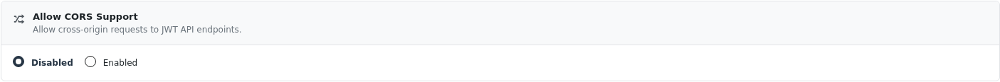
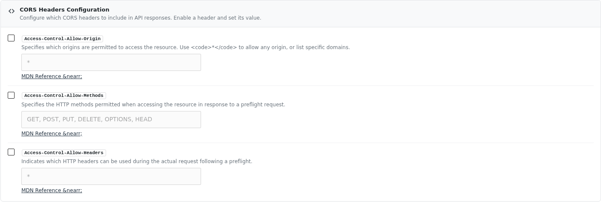

Simple JWT Login includes built-in Cross-Origin Resource Sharing (CORS) support, implemented in compliance with the [W3C CORS specification](https://www.w3.org/TR/cors/).

CORS controls which external origins (domains, ports, protocols) are permitted to call the plugin's REST endpoints from a browser. Without the appropriate CORS headers, browsers block cross-origin requests for security reasons.

Configure CORS under **Settings → Simple JWT Login → CORS**.

## When you need CORS

Enable CORS if your front-end application lives on a different domain than your WordPress site. Common scenarios:

- **Headless WordPress** - front-end on `app.example.com`, WordPress on `api.example.com`
- **Single-page applications** built with React, Vue, Angular, or similar frameworks
- **Mobile apps** that enforce CORS in their HTTP client

## Settings

### Allow CORS Support



Enable or disable CORS header injection on all plugin responses. When disabled, no CORS headers are added.

---

### CORS Headers Configuration



Enable each header individually and configure its value:

#### `Access-Control-Allow-Origin`

Specifies which origins are permitted to access the resource.

| Value | Behaviour |
| :---- | :-------- |
| `*` | Any origin is allowed. Since version 4.1.0, the plugin echoes the request's `Origin` back instead of a literal `*`, so credentialed requests (cookies, `Authorization`) also work |
| `https://app.example.com` | Only that specific origin is allowed |
| `https://app1.com, https://app2.com` | Multiple specific origins (comma-separated). When the request's `Origin` matches one of them, that origin is echoed back |

Default example value: `*`

:::warning Required for cross-origin JWT requests
Since version 4.1.1, a browser app on another origin can only authenticate with a JWT if its origin is listed here. A `*` entry trusts the `Authorization: Bearer` header only, never the cookie or session JWT - list the exact origin if your app relies on cookies. With CORS disabled, or this header turned off, a JWT sent from another site's page is ignored. See [Cross-site requests](/docs/configuration/#cross-site-requests).
:::

Since version 4.1.0, CORS headers are also added to REST error responses (for example, the `401`/`403` errors returned by JWT authentication and Protect Endpoints), so browser clients can read the error body instead of seeing a generic CORS failure.

[MDN Reference](https://developer.mozilla.org/en-US/docs/Web/HTTP/Headers/Access-Control-Allow-Origin)

---

#### `Access-Control-Allow-Methods`

Lists the HTTP methods permitted when accessing the resource in response to a browser preflight (`OPTIONS`) request.

Example value: `GET, POST, OPTIONS`

[MDN Reference](https://developer.mozilla.org/en-US/docs/Web/HTTP/Headers/Access-Control-Allow-Methods)

---

#### `Access-Control-Allow-Headers`

Lists which HTTP request headers can be used during the actual cross-origin request.

Example value: `Content-Type, Authorization`

Include `Authorization` if you send JWTs via the `Authorization: Bearer` header.

[MDN Reference](https://developer.mozilla.org/en-US/docs/Web/HTTP/Headers/Access-Control-Allow-Headers)

---

## Recommended configuration for headless WordPress

```
Access-Control-Allow-Origin:  https://your-frontend-domain.com
Access-Control-Allow-Methods: GET, POST, PUT, DELETE, OPTIONS
Access-Control-Allow-Headers: Content-Type, Authorization
```

A wildcard `Access-Control-Allow-Origin: *` is simpler to configure and generally safe for JWT-protected APIs (tokens cannot be forged), but restricting to your specific front-end origin is a good defense-in-depth measure.

