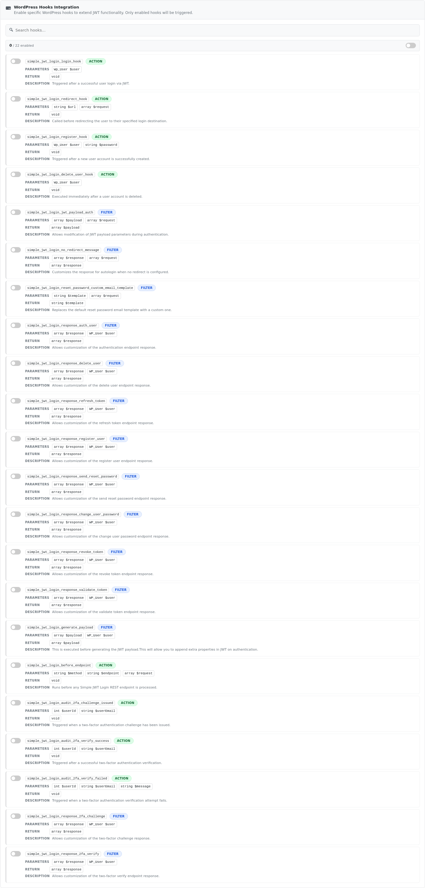

Simple JWT Login exposes **39 WordPress action and filter hooks** that let you extend or customize the plugin's behavior without modifying its source code. Use them to enrich JWT payloads, send notifications, apply business logic, gate requests, or build fully custom flows on top of the plugin.

The hooks come in two groups, and each group is switched on in a different place:

- **19 general hooks** (the [Quick Reference](#quick-reference) table) - enable each one in **Settings → Simple JWT Login → Hooks**.
- **20 audit hooks** (see [Audit Hooks](#audit-hooks)) - they fire when [audit logging](./AuditLogs.md) is enabled and the matching event is selected.

:::warning Enable hooks first
**All hooks are disabled by default.** A hook that isn't enabled never fires, even if your code calls `add_action()` or `add_filter()` for it.
:::


## Quick Reference

| Hook | Type | Triggered |
|------|------|-----------|
| [`simple_jwt_login_before_endpoint`](#simple_jwt_login_before_endpoint) | action | Before any endpoint is processed |
| [`simple_jwt_login_login_hook`](#simple_jwt_login_login_hook) | action | After a user logs in |
| [`simple_jwt_login_redirect_hook`](#simple_jwt_login_redirect_hook) | action | Before the post-login redirect |
| [`simple_jwt_login_register_hook`](#simple_jwt_login_register_hook) | action | After a new user is created |
| [`simple_jwt_login_delete_user_hook`](#simple_jwt_login_delete_user_hook) | action | After a user is deleted |
| [`simple_jwt_login_jwt_payload_auth`](#simple_jwt_login_jwt_payload_auth) | filter | Before the JWT is signed on `/auth` |
| [`simple_jwt_login_no_redirect_message`](#simple_jwt_login_no_redirect_message) | filter | Before the no-redirect response on `/autologin` |
| [`simple_jwt_login_reset_password_custom_email_template`](#simple_jwt_login_reset_password_custom_email_template) | filter | Before the reset-password email is sent |
| [`simple_jwt_login_response_auth_user`](#simple_jwt_login_response_auth_user) | filter | Before the `/auth` response is returned |
| [`simple_jwt_login_response_register_user`](#simple_jwt_login_response_register_user) | filter | Before the register response is returned |
| [`simple_jwt_login_response_delete_user`](#simple_jwt_login_response_delete_user) | filter | Before the delete-user response is returned |
| [`simple_jwt_login_response_refresh_token`](#simple_jwt_login_response_refresh_token) | filter | Before the refresh-token response is returned |
| [`simple_jwt_login_response_send_reset_password`](#simple_jwt_login_response_send_reset_password) | filter | Before the send-reset-password response is returned |
| [`simple_jwt_login_response_change_user_password`](#simple_jwt_login_response_change_user_password) | filter | Before the change-password response is returned |
| [`simple_jwt_login_response_revoke_token`](#simple_jwt_login_response_revoke_token) | filter | Before the revoke-token response is returned |
| [`simple_jwt_login_response_validate_token`](#simple_jwt_login_response_validate_token) | filter | Before the validate-token response is returned |
| [`simple_jwt_login_generate_payload`](#simple_jwt_login_generate_payload) | filter | Before a JWT payload is generated (any endpoint) |
| [`simple_jwt_login_response_2fa_challenge`](#simple_jwt_login_response_2fa_challenge) | filter | Before the 2FA challenge response is returned |
| [`simple_jwt_login_response_2fa_verify`](#simple_jwt_login_response_2fa_verify) | filter | Before the 2FA verify response is returned |

---

## Action Hooks

Action hooks let you run side-effect code at a specific point in the request lifecycle. They do not return a value.

### `simple_jwt_login_before_endpoint`

Fires before a Simple JWT Login REST route is processed. Use it to validate requests, block specific callers, enforce policies (for example, minimum password length), or log activity - for any endpoint.

| Parameter | Type | Description |
|-----------|------|-------------|
| `$method` | `string` | HTTP method (`GET`, `POST`, …) |
| `$endpoint` | `string` | Endpoint name (`auth`, `users`, …) |
| `$request` | `array` | Full request parameters |

Throw an `Exception` to abort the request with an error response.

---

### `simple_jwt_login_login_hook`

Fires after a user has been successfully authenticated and logged in.

| Parameter | Type | Description |
|-----------|------|-------------|
| `$user` | `WP_User` | The authenticated user |

---

### `simple_jwt_login_redirect_hook`

Fires before the user is redirected to the URL configured in the Login settings. Use it to implement dynamic redirect logic based on request parameters.

| Parameter | Type | Description |
|-----------|------|-------------|
| `$url` | `string` | The configured redirect URL |
| `$request` | `array` | Full request parameters |

:::tip
Enable **"Include request parameters in the redirect URL"** in Login settings to forward custom query parameters (for example, `&page=dashboard`) that your hook can read.
:::

---

### `simple_jwt_login_register_hook`

Fires after a new user has been created via the register endpoint.

| Parameter | Type | Description |
|-----------|------|-------------|
| `$user` | `WP_User` | The newly created user |
| `$plain_text_password` | `string` | The user's plain-text password (available only at creation time) |

---

### `simple_jwt_login_delete_user_hook`

Fires immediately after a user has been deleted.

| Parameter | Type | Description |
|-----------|------|-------------|
| `$user` | `WP_User` | The deleted user |

---

## Filter Hooks

Filter hooks let you inspect and modify data before it is used or returned. Always return the (modified) value.

### `simple_jwt_login_jwt_payload_auth`

Fires on the `/auth` endpoint before the JWT is signed. Use it to add custom claims to the token.

| Parameter | Type | Description |
|-----------|------|-------------|
| `$payload` | `array` | The JWT payload (modify and return) |
| `$request` | `array` | Full request parameters |

**Returns:** `array` - the modified payload.

---

### `simple_jwt_login_no_redirect_message`

Fires on the `/autologin` endpoint when **No Redirect** is selected. Use it to customize the JSON response returned to the client.

| Parameter | Type | Description |
|-----------|------|-------------|
| `$payload` | `array` | The response payload (modify and return) |
| `$request` | `array` | Full request parameters |

**Returns:** `array` - the modified response payload.

---

### `simple_jwt_login_reset_password_custom_email_template`

Fires when `POST /user/reset_password` is called. Use it to replace the default email template set in Reset Password settings with a fully custom HTML email.

| Parameter | Type | Description |
|-----------|------|-------------|
| `$template` | `string` | The current email template |
| `$request` | `array` | Full request parameters |

**Returns:** `string` - the custom email template.

---

### Response Filters

The following 8 filters fire immediately before their respective endpoint returns a JSON response. Use them to add, remove, or transform fields in the API response.

#### `simple_jwt_login_response_auth_user`

Fires before the `POST /auth` response is returned.

| Parameter | Type | Description |
|-----------|------|-------------|
| `$response` | `array` | The response data (modify and return) |
| `$user` | `WP_User` | The user associated with the request |

**Returns:** `array` - the modified response.

---

#### `simple_jwt_login_response_register_user`

Fires before the `POST /users` (register) response is returned.

| Parameter | Type | Description |
|-----------|------|-------------|
| `$response` | `array` | The response data (modify and return) |
| `$user` | `WP_User` | The user associated with the request |

**Returns:** `array` - the modified response.

---

#### `simple_jwt_login_response_delete_user`

Fires before the `DELETE /users` response is returned.

| Parameter | Type | Description |
|-----------|------|-------------|
| `$response` | `array` | The response data (modify and return) |
| `$user` | `WP_User` | The user associated with the request |

**Returns:** `array` - the modified response.

---

#### `simple_jwt_login_response_refresh_token`

Fires before the `POST /auth/refresh` response is returned.

| Parameter | Type | Description |
|-----------|------|-------------|
| `$response` | `array` | The response data (modify and return) |
| `$user` | `WP_User` | The user associated with the request |

**Returns:** `array` - the modified response.

---

#### `simple_jwt_login_response_send_reset_password`

Fires before the `POST /user/reset_password` response is returned.

:::caution
Since version 4.2.0, this filter runs only for emails that belong to a user. If it changes the response or adds a delay, callers can tell which emails have an account.
:::

| Parameter | Type | Description |
|-----------|------|-------------|
| `$response` | `array` | The response data (modify and return) |
| `$user` | `WP_User` | The user associated with the request |

**Returns:** `array` - the modified response.

---

#### `simple_jwt_login_response_change_user_password`

Fires before the `PUT /user/reset_password` response is returned.

| Parameter | Type | Description |
|-----------|------|-------------|
| `$response` | `array` | The response data (modify and return) |
| `$user` | `WP_User` | The user associated with the request |

**Returns:** `array` - the modified response.

---

#### `simple_jwt_login_response_revoke_token`

Fires before the `DELETE /auth` response is returned.

| Parameter | Type | Description |
|-----------|------|-------------|
| `$response` | `array` | The response data (modify and return) |
| `$user` | `WP_User` | The user associated with the request |

**Returns:** `array` - the modified response.

---

#### `simple_jwt_login_response_validate_token`

Fires before the `GET /auth/validate` response is returned.

| Parameter | Type | Description |
|-----------|------|-------------|
| `$response` | `array` | The response data (modify and return) |
| `$user` | `WP_User` | The user associated with the request |

**Returns:** `array` - the modified response.

---

### `simple_jwt_login_generate_payload`

Fires before the JWT payload is generated on any endpoint (not just `/auth`). Use it to append extra claims to every JWT issued by the plugin, regardless of which endpoint generates the token.

| Parameter | Type | Description |
|-----------|------|-------------|
| `$payload` | `array` | The JWT payload (modify and return) |
| `$user` | `WP_User` | The user for whom the token is being generated |

**Returns:** `array` - the modified payload.

---

## 2FA Hooks

These filters work with the Two-Factor Authentication integration. Enable Two-Factor in **Settings → Integrations → Third Party → Two-Factor**, then enable each filter in **Settings → Simple JWT Login → Hooks**.

### `simple_jwt_login_response_2fa_challenge`

Fires before `POST /auth` returns the interim 2FA token (instead of a JWT) for a user who has two-factor authentication set up. Use it to add extra fields or transform the response.

| Parameter | Type | Description |
|-----------|------|-------------|
| `$response` | `array` | The response data (modify and return) |
| `$user` | `WP_User` | The user associated with the request |

**Returns:** `array` - the modified response.

---

### `simple_jwt_login_response_2fa_verify`

Fires before the `POST /auth/2fa` response is returned.

| Parameter | Type | Description |
|-----------|------|-------------|
| `$response` | `array` | The response data (modify and return) |
| `$user` | `WP_User` | The user associated with the request |

**Returns:** `array` - the modified response.

---

## Audit Hooks

Audit hooks are actions that fire for each [audit log](./AuditLogs.md) event. They are not listed in the **Hooks** settings. Instead, a hook fires only when **Enable Audit Logging** is on and its event is selected under **Settings → Simple JWT Login → Audit Logs → Config**. Use them to send authentication events to your own monitoring or alerting system.

All audit hooks receive the same arguments:

| Parameter | Type | Description |
|-----------|------|-------------|
| `$userId` | `int` or `null` | WordPress user ID, or `null` when the user is unknown |
| `$userEmail` | `string` or `null` | User's email address (on failures, the email that was attempted), or `null` when unknown |
| `$message` | `string` | Failure reason. Passed to `*_failed` hooks only |

| Hook | Audit event | Fires when |
|------|-------------|------------|
| `simple_jwt_login_audit_auth_login_success` | `auth.login.success` | `/auth` issues a JWT |
| `simple_jwt_login_audit_auth_login_failed` | `auth.login.failed` | `/auth` rejects the credentials |
| `simple_jwt_login_audit_auth_logout_success` | `auth.logout.success` | `/auth/revoke` revokes a JWT |
| `simple_jwt_login_audit_auth_logout_failed` | `auth.logout.failed` | `/auth/revoke` fails |
| `simple_jwt_login_audit_auth_register_success` | `auth.register.success` | `/users` creates a user |
| `simple_jwt_login_audit_auth_register_failed` | `auth.register.failed` | `/users` fails to create a user |
| `simple_jwt_login_audit_password_reset_request` | `auth.password_reset.request` | A password reset code is requested |
| `simple_jwt_login_audit_password_reset_success` | `auth.password_reset.success` | A password is changed |
| `simple_jwt_login_audit_password_reset_failed` | `auth.password_reset.failed` | A password reset or change fails |
| `simple_jwt_login_audit_delete_user_success` | `auth.delete_user.success` | `DELETE /users` deletes a user |
| `simple_jwt_login_audit_delete_user_failed` | `auth.delete_user.failed` | `DELETE /users` fails |
| `simple_jwt_login_audit_login_session_success` | `auth.login_session.success` | `/autologin` logs a user in |
| `simple_jwt_login_audit_login_session_failed` | `auth.login_session.failed` | `/autologin` fails |
| `simple_jwt_login_audit_refresh_token_success` | `auth.refresh_token.success` | `/auth/refresh` issues a new JWT |
| `simple_jwt_login_audit_refresh_token_failed` | `auth.refresh_token.failed` | `/auth/refresh` fails |
| `simple_jwt_login_audit_oauth_success` | `auth.oauth.success` | An OAuth login succeeds |
| `simple_jwt_login_audit_oauth_failed` | `auth.oauth.failed` | An OAuth login fails |
| [`simple_jwt_login_audit_2fa_challenge_issued`](#simple_jwt_login_audit_2fa_challenge_issued) | `auth.2fa.challenge_issued` | A 2FA challenge is issued |
| [`simple_jwt_login_audit_2fa_verify_success`](#simple_jwt_login_audit_2fa_verify_success) | `auth.2fa.verify_success` | A 2FA code is verified |
| [`simple_jwt_login_audit_2fa_verify_failed`](#simple_jwt_login_audit_2fa_verify_failed) | `auth.2fa.verify_failed` | A 2FA verification fails |

```php
add_action('simple_jwt_login_audit_auth_login_failed', function ($userId, $userEmail, $message) {
    error_log(sprintf('JWT login failed for %s: %s', $userEmail ?? 'unknown', $message));
}, 10, 3);
```

### `simple_jwt_login_audit_2fa_challenge_issued`

Fires when a two-factor authentication challenge has been issued (that is, after the user submits valid credentials and an interim JWT is returned, triggering a 2FA code delivery).

| Parameter | Type | Description |
|-----------|------|-------------|
| `$userId` | `int` | WordPress user ID |
| `$userEmail` | `string` | User's email address |

---

### `simple_jwt_login_audit_2fa_verify_success`

Fires after a successful two-factor authentication verification.

| Parameter | Type | Description |
|-----------|------|-------------|
| `$userId` | `int` | WordPress user ID |
| `$userEmail` | `string` | User's email address |

---

### `simple_jwt_login_audit_2fa_verify_failed`

Fires when a two-factor authentication verification attempt fails.

| Parameter | Type | Description |
|-----------|------|-------------|
| `$userId` | `int` | WordPress user ID |
| `$userEmail` | `string` | User's email address |
| `$message` | `string` | Human-readable failure reason |

---

## Settings Screenshot



---

## Code Examples

### Add custom claims to the JWT payload

Enrich the token with user metadata (roles, plan, tenant ID) so downstream services don't need a separate lookup.

```php
add_filter('simple_jwt_login_jwt_payload_auth', function (array $payload, array $request): array {
    $user = get_user_by('email', $request['email'] ?? '');
    if ($user) {
        $payload['roles'] = $user->roles;
        $payload['display_name'] = $user->display_name;
    }
    return $payload;
}, 10, 2);
```

---

### Send a welcome email after registration

```php
add_action('simple_jwt_login_register_hook', function (WP_User $user, string $password): void {
    wp_mail(
        $user->user_email,
        'Welcome to My Site',
        sprintf(
            "Hi %s,\n\nYour account is ready.\n\nEmail: %s\nPassword: %s",
            $user->display_name,
            $user->user_email,
            $password
        )
    );
}, 10, 2);
```

---

### Dynamic redirect URLs after login

Enable **"Include request parameters in the redirect URL"** in Login settings, then add `&page=dashboard` (or any value) to the login URL. The hook reads it and redirects accordingly.

```php
add_action('simple_jwt_login_redirect_hook', function (string $url, array $request): void {
    $page = $request['page'] ?? null;

    $destinations = [
        'dashboard' => 'https://mysite.com/dashboard',
        'profile'   => 'https://mysite.com/profile',
    ];

    wp_redirect($destinations[$page] ?? $url);
}, 10, 2);
```

---

### Block a specific email address on `/auth`

```php
add_action('simple_jwt_login_before_endpoint', function (string $method, string $endpoint, array $request): void {
    if ($method !== 'POST' || $endpoint !== 'auth') {
        return;
    }

    $blocked = ['banned@example.com'];

    if (in_array($request['email'] ?? '', $blocked, true)) {
        throw new Exception('This account has been suspended.');
    }
}, 10, 3);
```

---

### Enforce a minimum password length on registration

```php
add_action('simple_jwt_login_before_endpoint', function (string $method, string $endpoint, array $request): void {
    if ($method !== 'POST' || $endpoint !== 'users') {
        return;
    }

    $minLength = 8;
    $password  = $request['password'] ?? '';

    if (strlen($password) < $minLength) {
        throw new Exception("Password must be at least {$minLength} characters.");
    }
}, 10, 3);
```

---

### Add extra fields to the auth response

```php
add_filter('simple_jwt_login_response_auth_user', function (array $response, WP_User $user): array {
    $response['user_id']      = $user->ID;
    $response['display_name'] = $user->display_name;
    $response['avatar_url']   = get_avatar_url($user->ID);
    return $response;
}, 10, 2);
```

## Next steps

- [Notify external services with webhooks](./Webhooks.md)
