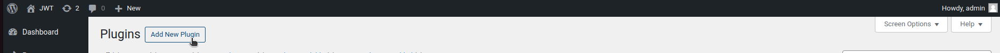
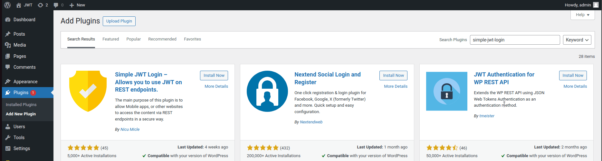
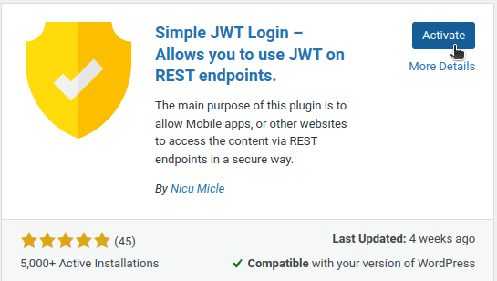
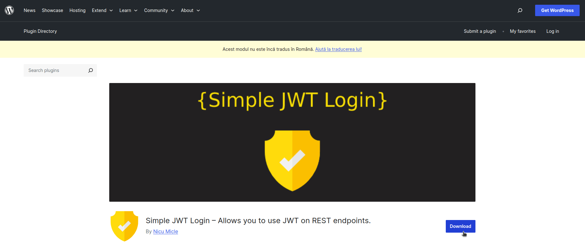
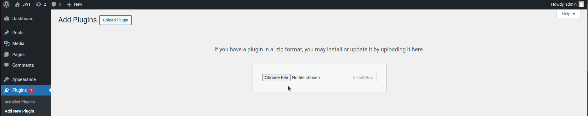

**Simple-JWT-Login** is a free, open-source WordPress plugin that adds JSON Web Token (JWT) authentication to the WordPress REST API. It lets mobile apps, single-page applications, and external services securely interact with your WordPress site - without exposing admin credentials.

With Simple-JWT-Login you can:
- **Authenticate** users and receive a signed JWT
- **Auto-login** users via a tokenized link
- **Register** and **delete** users programmatically
- **Reset and change passwords** through the REST API
- **Protect any REST endpoint** so it requires a valid JWT
- **Refresh, validate, and revoke** tokens to manage session lifecycle

Whether you're building a headless WordPress site, a React/Vue front-end, a mobile app, or a third-party integration, Simple-JWT-Login provides a clean, standards-based authentication layer.

:::tip[New here?]
Follow the [Quick Start](./Quick-Start.md) - get a JWT and make your first authenticated call in 5 minutes. Already set up? See every route in the [Endpoints overview](./Endpoints.md).
:::

## Find by task

| Task | Where to look |
| :--- | :------------ |
| Log a user in and get a JWT | [Authentication](./auth/Authentication.md) |
| Send the JWT with each request | [JWT Input Sources](./Configuration.mdx#jwt-input-sources) |
| Call `/wp/v2/*` or custom routes as the logged-in user | [JWT Middleware](./Configuration.mdx#jwt-middleware-for-all-wordpress-endpoints) |
| Keep users logged in without asking for the password again | [Refresh token](./auth/RefreshToken.md) |
| Log a user out | [Revoke token](./auth/RevokeToken.md) |
| Check that a JWT is still valid | [Validate token](./auth/ValidateToken.md) |
| Let users sign up from an app | [Register user](./Register-User.md) |
| Let users reset a forgotten password | [Reset password](./Reset-Password.md) |
| Open a logged-in WordPress session from a link | [Autologin](./Login-User.md) |
| Require a JWT, or a role, for some REST routes | [Protect endpoints](./Protect-Endpoints.md) |
| Call the API from a browser on another domain | [CORS](./Cors.md) |
| Log in with Google, Auth0, Facebook, or GitHub | [OAuth](./integrations/OAuth/index.md) |
| Add two-factor authentication | [Two-Factor](./integrations/ThirdParty/02_TwoFactor.md) |
| Use JWTs with WPGraphQL | [WPGraphQL](./integrations/ThirdParty/01_WPGraphQL.md) |
| Build a headless WooCommerce store | [WooCommerce](./integrations/ThirdParty/04_WooCommerce.md) |
| Authenticate server-to-server without a user password | [API keys](./API-Keys.md) |
| Accept JWTs issued by another service (such as Auth0 or Firebase) | [JWT Verification Rules](./Configuration.mdx#jwt-verification-rules) |
| Add custom claims to the JWT | [Authentication - custom claims](./auth/Authentication.md#custom-payload-claims) |
| Run custom code on login, register, and other events | [Hooks](./Hooks.md) |
| Notify another system when something happens | [Webhooks](./Webhooks.md) |
| Understand an error response | [Error codes](./Error-Codes.md) |
| See complete working code | [Code examples](./code_examples/index.mdx) |

## Requirements

### Minimum requirements

- WordPress **6.2** or higher (since plugin version 4.2.0, previously 4.4.0)
- PHP **5.5** or higher for the plugin code itself

The plugin code stays compatible with PHP 5.5, but WordPress sets its own PHP floor. WordPress 6.2 requires PHP **5.6.20+**, and WordPress 6.6 and later require PHP **7.2.24+**. In practice, your PHP version is set by the WordPress version you run.

### Recommended for production

- The latest WordPress release
- A PHP version that still receives security updates (PHP **8.2** or newer)
- HTTPS on every request that carries a JWT

## License

Simple-JWT-Login is open-source and distributed under the [GPL 3.0](https://github.com/nicumicle/simple-jwt-login/blob/master/LICENSE) License.

## Installation Guide

Setting up Simple-JWT-Login is quick and easy. Choose one of the following installation methods:

### Method 1 - Install from WordPress.org (Recommended)
- Go to the **Plugins** menu in WordPress and click **Add New**.

    
- Search for **Simple JWT Login** and select **Install Now**.

    
- **Activate** the plugin when prompted.

    

### Method 2 - Download and Install Manually
- Access [https://wordpress.org/plugins/simple-jwt-login/](https://wordpress.org/plugins/simple-jwt-login/).

- Click "**Download**" to get the latest Simple-JWT-Login plugin version.

    

- Upload the `.zip` file via the WordPress plugin uploader (**Plugins → Add New → Upload Plugin**).

    

- Click "**Install Now**" and **Activate** the plugin.

   

Now that you've installed **Simple-JWT-Login**, follow the [Quick Start](./Quick-Start.md) to get your first JWT, or see the [Configuration guide](./Configuration.mdx) to set up your JWT secret key and enable the features you need.
