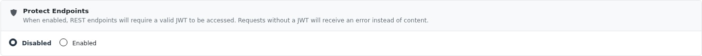
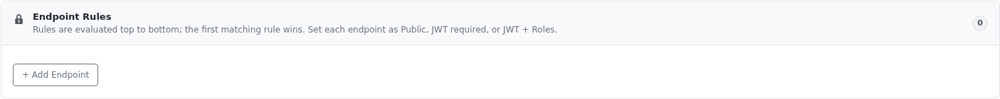
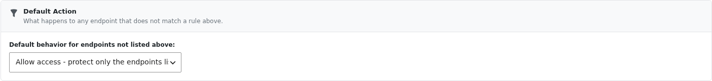

The Protect Endpoints feature lets you require a valid JWT for any WordPress REST API route. Use it to lock down sensitive data, such as user profiles, private posts, or custom post types, so only authenticated callers can access it, optionally restricted to specific WordPress roles.

When a protected endpoint is called without a valid JWT, the plugin returns a `401` error immediately, before WordPress processes the request:

```json
{
  "success": false,
  "data": {
    "message": "You are not authorized to access this endpoint.",
    "error_code": 75
  }
}
```

If a valid JWT is provided but the user doesn't have one of the roles required by a **JWT + Roles** rule, the plugin returns a `403` error instead:

```json
{
  "success": false,
  "data": {
    "message": "You do not have the required role to access this endpoint.",
    "error_code": 114
  }
}
```

## Settings

Configure under **Settings → Simple JWT Login → Protect Endpoints**.

### Protect Endpoints



Enable or disable the endpoint protection feature. When disabled, no JWT check is applied to any REST route.

### Endpoint Rules



Define per-endpoint rules. Click **+ Add Endpoint** to add a rule. Rules are evaluated top to bottom - the first matching rule wins.

Since version 4.2.0, rules match the route and HTTP method WordPress actually dispatches. Alternate URLs such as `/index.php/wp-json/...` and method overrides (`?_method=` or `X-HTTP-Method-Override`) can't be used to get around a rule.

Since version 4.2.0, requests to the WordPress batch endpoint (`/batch/v1`) and `_embed` sub-requests are checked too: each sub-request is matched against the rules with its own route and method.

**Each rule has the following fields:**

| Field | Options | Description |
| :---- | :------ | :---------- |
| HTTP Method | ALL, GET, POST, PUT, PATCH, DELETE | Which request methods the rule applies to. |
| Match type | Starts with, Exact match | Whether the path must start with the value or match it exactly. |
| Endpoint | text input | The REST API path to match (for example, `/wp/v2/users`). |
| Type | Public, JWT required, JWT + Roles | **Public** - always accessible, even with protection enabled by default. **JWT required** - a valid JWT is required, for any authenticated user. **JWT + Roles** - a valid JWT is required *and* the user must have at least one of the specified WordPress roles. |
| Roles | comma-separated list | Only shown when Type is **JWT + Roles**. WordPress roles allowed to access the endpoint (for example, `administrator, editor`). |

### Default Action



Controls what happens to any endpoint that doesn't match any of the preceding rules:

| Option | Behavior |
| :----- | :------- |
| **Allow access - protect only the endpoints listed above** | All REST routes are public by default. Only endpoints matching a **JWT required** or **JWT + Roles** rule need a JWT. |
| **Require a valid JWT - keep only the endpoints listed above public** | All REST routes require a JWT by default. Only endpoints matching a **Public** rule stay public. |

---

## Example Configurations

####  Example 1
Assume you add a rule for `/wp/v2/users` with `ALL` and `Exact Match`.

The rule applies to these URLs:
- `http://yoursite.com/?rest_route=/wp/v2/users`
- `http://yoursite.com/wp-json/wp/v2/users`

#### Example 2
Assume you add a rule for `/wp/v2/users` with `GET` and `Starts With`.

The rule applies to these URLs when called with `GET` only:
- `http://yoursite.com/?rest_route=/wp/v2/users`
- `http://yoursite.com/?rest_route=/wp/v2/users/1`
- `http://yoursite.com/wp-json/wp/v2/users`
- `http://yoursite.com/wp-json/wp/v2/users/1`
- `http://yoursite.com/wp-json/wp/v2/users/{any_other_path}`

#### Example 3
Assume you add a rule for `/wp/v2` with `ALL`, `Starts With` and Type `JWT required`, and set the **Default Action** to `Allow access - protect only the endpoints listed above`.

This way, all the endpoints under `/wp/v2*` are protected and accessible only with a JWT.

For example, all these endpoints are protected:
- `/wp/v2/users` 
- `/wp/v2/posts`
- `/wp/v2/comments`

#### Example 4
Assume you add a rule for `/wp/v2/users` with `ALL`, `Starts With` and Type `JWT + Roles`, with Roles set to `administrator, editor`.

Only users with a valid JWT *and* the `administrator` or `editor` role can access `/wp/v2/users` and its sub-paths. Any other authenticated or anonymous request receives the "You do not have the required role to access this endpoint." error.

## Logged-in Users and API Keys

Since version 4.1.0, requests from users already logged in to WordPress (cookie + nonce authentication, as used by the block editor and other plugins) and requests authenticated with an [API key](/docs/api-keys/) don't need a JWT to pass a **JWT required** rule.

**JWT + Roles** rules still apply to them: the logged-in user, or the API key's owner, must have one of the listed roles. Otherwise the request is rejected the same way as a JWT request with the wrong role.

## How to Pass the JWT

The JWT can be provided in multiple ways, depending on the options set in the plugin’s General settings:
- Header
- Request URI
- Request Body
- Session
- Cookie

Since version 4.1.1, header, cookie and session JWTs are ignored on requests from other sites unless their origin is listed in the CORS **Allow origin** setting. See [Cross-site requests](/docs/configuration/#cross-site-requests).

### Examples

#### Sending JWT in header

```bash
curl -X POST "http://localhost/wp-json/wp/v2/users" \
  -H "Authorization: Bearer YOUR_JWT"
```

#### Sending JWT as query parameter

```bash
curl -X POST "http://localhost/wp-json/wp/v2/users?jwt=YOUR_JWT"
```

#### Sending JWT using `rest_route`

```bash
curl -X POST "http://localhost/?rest_route=/wp/v2/users&jwt=YOUR_JWT"
```

#### Sending JWT in request body

```bash
curl -X POST "http://localhost/wp-json/wp/v2/users" \
  -H "Content-type: application/json" \
  -d '{"JWT":"YOUR_JWT"}'
```

