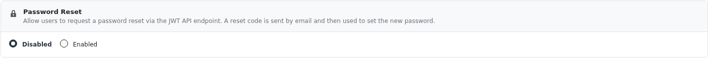
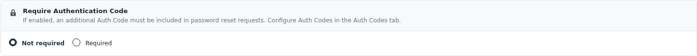
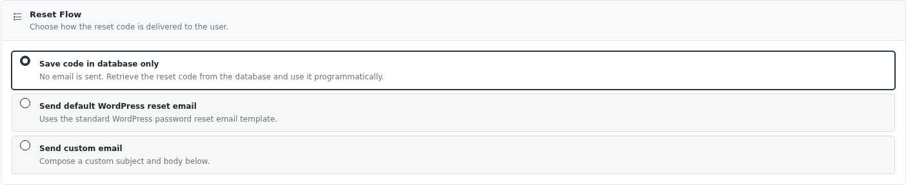
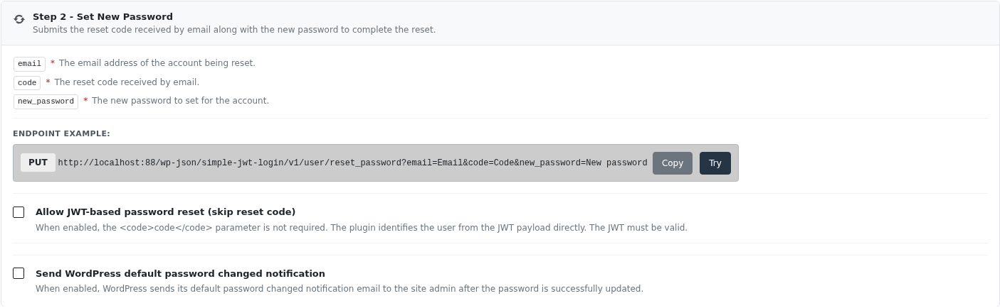

Simple JWT Login exposes a two-step password reset flow entirely through the REST API. Step 1 requests a reset code and delivers it by email; Step 2 applies the new password using that code. Both steps share the same endpoint URL with different HTTP methods.

---

## Step 1 - Request Reset Code

Send the user's email address to trigger the reset flow. The plugin generates a one-time code and delivers it according to the configured Reset Flow option.

:::note
Since version 4.2.0, an email that doesn't belong to any account gets the same `200` answer as a real one, but nothing is sent. This way the endpoint can't be used to find out which emails have an account. The attempt is still written to the [audit log](/docs/audit-logs/), and webhooks and the response hook only run for real users.

If you use the `simple_jwt_login_response_send_reset_password` filter or reset password webhooks, keep in mind that they run only for real users. If they change the response or add a delay, callers can tell which emails exist.
:::

:::tip[API Reference]
Explore and test this step using the [interactive API reference →](/api/v4/send-reset-password-code)
:::

### Endpoint

**METHOD**: `POST`

**ENDPOINT**: `/simple-jwt-login/v1/user/reset_password`

**URL Example**: `https://{{yoursite}}/?rest_route=/simple-jwt-login/v1/user/reset_password&email={{email}}&AUTH_KEY={{AUTH_KEY_VALUE}}`

**PARAMETERS**:

| Parameter | Type | Description |
| :-------: | :--: | ----------- |
| `email` | `required` `string` | The email address for which the password reset is requested. |
| `AUTH_KEY` | `optional` `string` | Auth Code value. Required only if "Require Authentication Code" is enabled. The parameter name matches the **Auth Code URL Key** in Auth Codes settings (default: `AUTH_KEY`). |

### Request

```json
{
  "email": "test@simplejwtlogin.com"
}
```

With optional Auth Code:

```json
{
  "email": "test@simplejwtlogin.com",
  "AUTH_KEY": "MY_SECRET_AUTH_KEY"
}
```

### Responses

#### 200

```json
{
  "success": true,
  "message": "Reset password email has been sent."
}
```

#### 400

Bad request - the `email` field is missing.

```json
{
  "success": false,
  "data": {
    "message": "Email is required.",
    "error_code": 59
  }
}
```

#### 401

Unauthorized - the provided auth code is invalid or missing when required.

```json
{
  "success": false,
  "data": {
    "message": "Invalid auth code.",
    "error_code": 58
  }
}
```

#### 403

Forbidden - password reset is disabled in plugin settings.

```json
{
  "success": false,
  "data": {
    "message": "Reset password is not allowed.",
    "error_code": 56
  }
}
```

#### 500

Internal server error (for example, email sending failure).

```json
{
  "success": false,
  "data": {
    "message": "An unexpected error occurred.",
    "error_code": 22
  }
}
```

### Examples

#### SHELL

```bash
curl -X POST https://simplejwtlogin.com/wp-json/simple-jwt-login/v1/user/reset_password \
  -H "Content-type: application/json" \
  -d '{"email":"test@simplejwtlogin.com"}'
```

#### PHP

```php
$simpleJwtLogin = new \SimpleJwtLoginClient\SimpleJwtLoginClient(
    'https://simplejwtlogin.com',
    '/simple-jwt-login/v1'
);
$result = $simpleJwtLogin->resetPassword('email@simplejwtlogin.com', 'AUTH CODE');
```

#### JavaScript

```js
fetch('https://simplejwtlogin.com/wp-json/simple-jwt-login/v1/user/reset_password', {
  method: 'POST',
  headers: { 'Content-Type': 'application/json' },
  body: JSON.stringify({ email: 'test@simplejwtlogin.com' })
}).then(r => r.json()).then(console.log);
```

### Error responses

| Code | Meaning |
| :--: | ------- |
| `56` | Password reset is not enabled in plugin settings. |
| `58` | Invalid Auth Code provided. |
| `59` | Email address is missing from the request. |
| `65` | Invalid flow type configured in plugin settings. |
| `66` | The `{{CODE}}` variable is missing from the custom email template. |

---

## Step 2 - Set New Password

Submit the reset code from Step 1 along with the new password. Alternatively, if **"Allow Reset password with JWT"** is enabled in settings, a valid JWT can be used instead of the code.

:::tip[API Reference]
Explore and test this step using the [interactive API reference →](/api/v4/change-user-password)
:::

### Endpoint

**METHOD**: `PUT`

**ENDPOINT**: `/simple-jwt-login/v1/user/reset_password`

**URL Example**: `https://{{yoursite}}/?rest_route=/simple-jwt-login/v1/user/reset_password`

:::warning[Keep credentials out of the URL]
Send the reset code and new password in the request body (JSON, as shown below), never in the query string. URLs are written to server logs, proxy logs, browser history and monitoring tools.
:::

**PARAMETERS**:

| Parameter | Type | Description |
| :-------: | :--: | ----------- |
| `email` | `required` `string` | The email address of the account being reset. |
| `code` | `required` `string` | The reset code received by email. Not required when a valid JWT is provided and "Allow Reset password with JWT" is enabled. |
| `new_password` | `required` `string` | The new password to set for the account. |
| `AUTH_KEY` | `optional` `string` | Auth Code value. Required only if "Require Authentication Code" is enabled. |
| `JWT` | `optional` `string` | Valid JWT identifying the user. When provided and JWT-based reset is enabled, the `code` parameter is not required. |

### Request

```json
{
  "email": "test@simplejwtlogin.com",
  "code": "MY_CODE",
  "new_password": "YOUR_SECRET_PASSWORD"
}
```

Using a JWT instead of a reset code:

```json
{
  "email": "test@simplejwtlogin.com",
  "JWT": "YOUR_JWT_HERE",
  "new_password": "YOUR_SECRET_PASSWORD"
}
```

### Responses

#### 200

```json
{
  "success": true,
  "message": "User password has been changed."
}
```

#### 400

Bad request - `email`, `code`, or `new_password` is missing.

```json
{
  "success": false,
  "data": {
    "message": "New password is required.",
    "error_code": 61
  }
}
```

#### 401

Unauthorized - the JWT is invalid or expired, or was already used for a password reset.

```json
{
  "success": false,
  "data": {
    "message": "This JWT cannot be used to change the password.",
    "error_code": 93
  }
}
```

#### 403

Forbidden - password reset is disabled in plugin settings.

```json
{
  "success": false,
  "data": {
    "message": "Reset password is not allowed.",
    "error_code": 56
  }
}
```

#### 404

No WordPress user with the provided email address was found.

```json
{
  "success": false,
  "data": {
    "message": "User not found.",
    "error_code": 64
  }
}
```

#### 422

Unprocessable entity - the one-time reset code is invalid or expired.

```json
{
  "success": false,
  "data": {
    "message": "Invalid reset password code.",
    "error_code": 62
  }
}
```

#### 500

Internal server error.

```json
{
  "success": false,
  "data": {
    "message": "An unexpected error occurred.",
    "error_code": 22
  }
}
```

### Examples

#### SHELL

```bash
curl -X PUT https://simplejwtlogin.com/wp-json/simple-jwt-login/v1/user/reset_password \
  -H "Content-type: application/json" \
  -d '{"email":"test@simplejwtlogin.com","code":"123","new_password":"test"}'
```

#### PHP

```php
$simpleJwtLogin = new \SimpleJwtLoginClient\SimpleJwtLoginClient(
    'https://simplejwtlogin.com',
    '/simple-jwt-login/v1'
);
$result = $simpleJwtLogin->changePassword('email@simplejwtlogin.com', 'new password', 'code', null, 'AUTH CODE');
```

#### JavaScript

```js
fetch('https://simplejwtlogin.com/wp-json/simple-jwt-login/v1/user/reset_password', {
  method: 'PUT',
  headers: { 'Content-Type': 'application/json' },
  body: JSON.stringify({
    email: 'test@simplejwtlogin.com',
    code: '123',
    new_password: 'test'
  })
}).then(r => r.json()).then(console.log);
```

### Error responses

| Code | Meaning |
| :--: | ------- |
| `56` | Password reset is not enabled in plugin settings. |
| `60` | The reset code is missing from the request. |
| `61` | The new password is missing from the request. |
| `62` | The reset code is invalid or does not match the email address. |
| `63` | Email address is missing from the request. |
| `64` | No WordPress user found with the provided email address. |
| `93` | The provided JWT cannot be used to change the password. |

JWT decoding errors (`1`-`22`) may also appear when a JWT is supplied and cannot be parsed or its signature is invalid.

---

## Settings

Configure under **Settings → Simple JWT Login → Reset Password**.

### Password Reset



Enable or disable the password reset feature. When disabled, both Step 1 and Step 2 return a 403 error.

### Require Authentication Code



When enabled, an additional Auth Code must be included in password reset requests. The parameter name is the **Auth Code URL Key** from Auth Codes settings (default: `AUTH_KEY`).

### Reset Flow



Choose how the reset code is delivered to the user after a successful Step 1 request:

| Option | Behavior |
| :----- | :------- |
| **Save code in database only** | No email is sent. The reset code is saved to the database. Use this when your front-end handles its own email delivery. |
| **Send default WordPress reset email** | Uses the standard WordPress password reset email template. |
| **Send custom email** | Sends a customizable email with your own subject and body. Subject and body are required when this option is selected. |

When **Send custom email** is selected, you can compose the subject and body and choose between **Plain text** or **HTML** format.

### Step 2 - Set New Password



#### Allow JWT-based password reset (skip reset code)

When enabled, the `code` parameter is not required. The plugin identifies the user directly from the JWT payload. The JWT must be valid and not expired.

#### Send WordPress default password changed notification

When enabled, WordPress sends its default password changed notification email to the site admin after the password is successfully updated.

:::tip
To log the user out everywhere after a reset (a stolen JWT or refresh token then stops working), turn on [Revoke sessions on password change](/docs/authentication/#revoke-sessions-on-password-change) in the Authentication settings.
:::

---

## Features

### Custom email template

When using the **Send custom email** flow, the body supports the following variables replaced at send time:

| Variable | Description |
| :------- | :---------- |
| `{{CODE}}` | **Required.** The reset password code the user must submit in Step 2. |
| `{{NAME}}` | User's full name (first + last) |
| `{{USERNAME}}` | WordPress username (`user_login`) |
| `{{EMAIL}}` | User's email address |
| `{{NICKNAME}}` | User's nickname |
| `{{FIRST_NAME}}` | User's first name |
| `{{LAST_NAME}}` | User's last name |
| `{{SITE}}` | Website URL |
| `{{IP}}` | IP address of the client that triggered the reset |

Example body:

```
Welcome {{FIRST_NAME}},

Your reset code for {{SITE}} is {{CODE}}.

This request was made from: {{IP}}
```

To use a fully custom template via code, use the `simple_jwt_login_reset_password_custom_email_template` filter:

```php
add_filter('simple_jwt_login_reset_password_custom_email_template', function($template, $request) {
    return "
        Hello {{FIRST_NAME}},
        Here is your reset password code.

        <b>Your code</b>: {{CODE}}
    ";
}, 10, 2);
```
