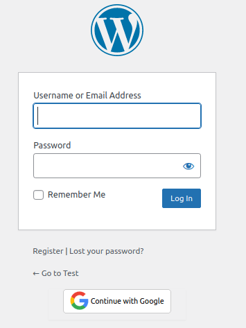

import styles from '../../styles.module.css';


##  Enable OAuth on WordPress login

This connects your WordPress site to Google authentication for a secure OAuth sign-in.
Once you enable this option, the WordPress login and register screens show a new `Continue with Google` button.

To enable OAuth on WordPress, it's crucial to ensure that you have the correct `return_uri` configured in Google.

:::note
Please make sure to set the following `return_uri` for "Authorized redirect URIs" in [https://console.cloud.google.com](https://console.cloud.google.com):
```
{{your_site}}/?rest_route=/simple-jwt-login/v1/oauth/token&provider=google
```
:::

To enable the `Continue with Google` button on your login screen, make sure you check the option `Enable OAuth on WordPress login` from WordPress.

## Create user if not exists

If some Google users may not have a WordPress account, select the `Create user if not exists` option from WordPress.
When someone signs in through OAuth and no user has a matching `user_email`, the plugin creates a new user with that email address and a random password.

For example, a new user can have:
```json
{
    "user_login": "user_23werowe",
    "user_email": "some_email@google.com",
    "password": "some-random-generated-password"
}
```

## Screenshot


