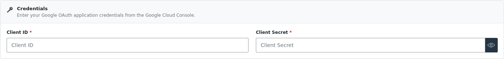

## Create a Google OAuth Application

1. Navigate to the [Google Cloud Console](https://console.developers.google.com/apis/).
2. Create a new project (or select an existing one).
3. Go to **Credentials** and click **+ Create Credentials → OAuth client ID**.
4. Choose **Web application** as the application type.
5. Under **Authorized redirect URIs**, add your site's callback URL:
   ```
   https://your-site.com/?rest_route=/simple-jwt-login/v1/oauth/token&provider=google
   ```
6. Copy the **Client ID** and **Client Secret**.

:::warning
Keep your credentials secure - never commit them to version control or expose them publicly. Use separate OAuth client IDs for each environment (development, staging, production).
:::

---

## Configure in WordPress

1. Go to **Simple JWT Login → Integrations → OAuth → Google**.
2. Enter the **Client ID** and **Client Secret** from the Google Cloud Console.
3. Set the **Redirect URI** to match what you registered in Google.



4. Toggle **Enable** to activate the Google provider.

## Next steps

- [Exchange a Google OAuth code for tokens](./02_Exchange_Code.md)
- [Exchange a Google token for a WordPress JWT](./03_Exchange_Token.md)
- [Add a Google login button with the shortcode](./04_Shortcode.md)
