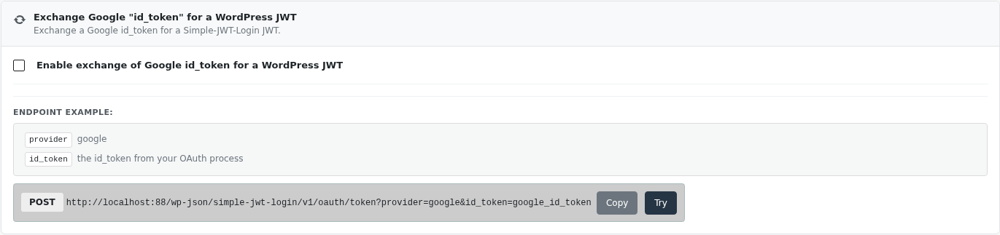

## Overview

This endpoint accepts a Google `id_token` and returns a WordPress JWT. Use this as the final step of the Google OAuth flow to authenticate the user in WordPress.

Enable **Exchange Google id_token for a WordPress JWT** in **Settings → Simple JWT Login → Integrations → OAuth → Google**.



:::note
Since version 4.2.0, the `id_token` must be issued for the Google **Client ID** configured in the plugin (its `aud` claim), on this endpoint and with **Allow usage on all endpoints**. A token issued for another client is rejected with `401` (error code `118`).
:::

:::danger Allow tokens issued for other Google clients
Turn on **Allow tokens issued for other Google clients** (off by default) to keep applications built for versions before 4.2.0 backward compatible: `id_token`s issued for other Google clients are accepted again. But then any Google OAuth client, including one created by an attacker, can get a valid `id_token` for a Google Account and exchange it for a WordPress JWT of the matching user. Turn it on only while you migrate your apps to the configured Client ID. See [Backward compatibility](/docs/integrations/oauth/#backward-compatibility).
:::

---

## Endpoint

**Method:** `POST`

**Endpoint:** `/simple-jwt-login/v1/oauth/token`

| Parameter | Type | Description |
| :-------- | :--- | :---------- |
| `provider` | `required` `string` | Set to `google` |
| `id_token` | `required` `string` | The Google `id_token` from your OAuth flow |

---

## Request Example

```bash
curl -X POST "https://your-site.com/wp-json/simple-jwt-login/v1/oauth/token" \
  -H "Content-Type: application/json" \
  -d '{"provider":"google","id_token":"YOUR_GOOGLE_ID_TOKEN"}'
```

---

## Response Examples

### Success

```json
{
  "success": true,
  "data": {
    "jwt": "eyJhbGciOiJIUzI1NiIsInR5cCI6IkpXVCJ9..."
  }
}
```

### Error

```json
{
  "success": false,
  "data": {
    "message": "The code or jwt parameter is missing from request.",
    "error_code": 71
  }
}
```
