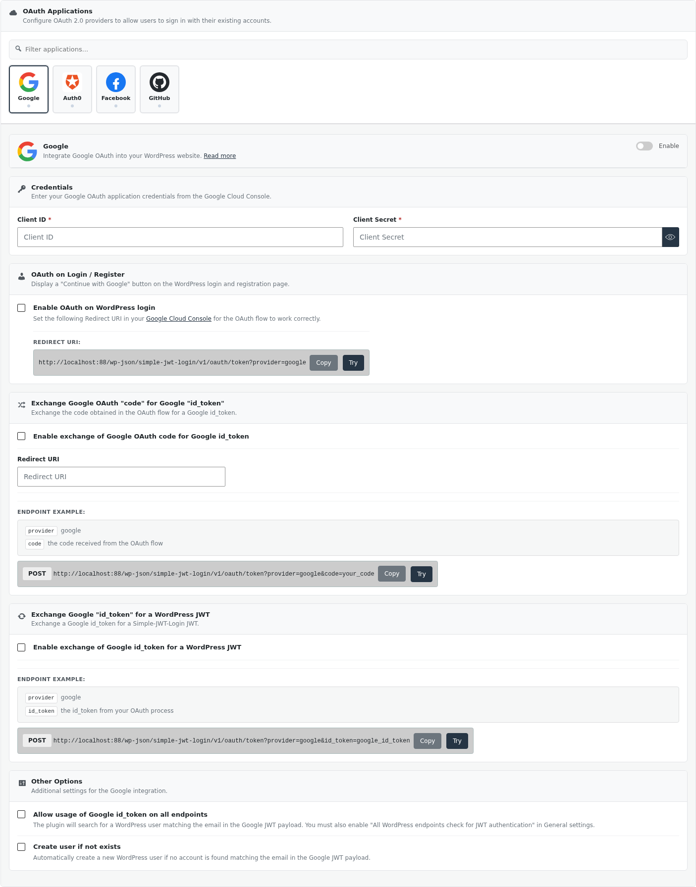
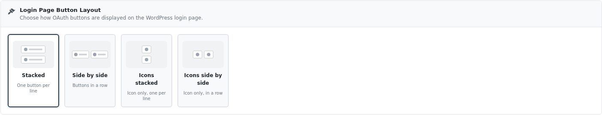
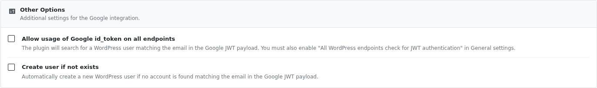
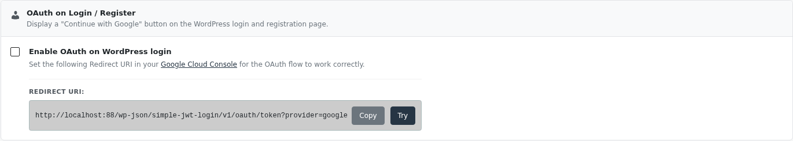

Simple JWT Login supports OAuth 2.0 authentication with four providers - **Google**, **Auth0**, **Facebook**, and **GitHub**. When configured, users can sign in with their existing provider accounts and receive a WordPress JWT in return.

Configure OAuth under **Settings → Simple JWT Login → Integrations → OAuth**.



---

## Login Page Button Layout

Controls how the "Continue with" buttons appear on the WordPress login and registration page.



| Option | Description |
| :----- | :---------- |
| **Stacked** | One full-width button per provider, stacked vertically |
| **Side by side** | All buttons in a single row |
| **Icons stacked** | Icon-only buttons, one per line |
| **Icons side by side** | Icon-only buttons in a single row |

---

## Shared Options

Each provider panel shares the same set of options.



### Enable

Toggle the provider on or off. When disabled, the provider's endpoints return errors.

### OAuth on Login / Register

When enabled, a "Continue with [Provider]" button appears on the WordPress login and registration page.



To make the OAuth redirect work, register the **Redirect URI** shown in the settings panel in the provider's developer console:

```
https://example.com/?rest_route=/simple-jwt-login/v1/oauth/token&provider={provider}
```

### Allow Usage on All Endpoints

When enabled, a valid provider token can authenticate requests to any WordPress REST endpoint (not just Simple JWT Login routes). The plugin looks up the WordPress user by the email address returned by the provider.

:::note
Requires "All WordPress endpoints check for JWT authentication" to also be enabled in **General** settings.
:::

### Create User if Not Exists

When enabled, the plugin automatically creates a new WordPress user if no account is found matching the email from the provider. New users receive the default role configured in the **Register** settings.

### Backward Compatibility

Since version 4.2.0, a provider token must be issued for the app configured in the plugin. Tokens obtained by other apps are rejected. If your applications still send such tokens, each provider has an option, off by default, that turns this check off:

| Provider | Option | Accepts again |
|----------|--------|---------------|
| Google | **Allow tokens issued for other Google clients** | `id_token`s whose `aud` is another Google Client ID, on the token exchange and with **Allow usage on all endpoints** |
| Auth0 | **Allow opaque access tokens** | Opaque `access_token`s, which can't be bound to the Auth0 Client ID |
| Facebook | **Allow tokens issued for other Facebook apps** | `access_token`s issued for another Facebook app |
| GitHub | **Allow tokens issued for other GitHub apps** | `access_token`s issued for another GitHub OAuth app, and personal access tokens |

:::danger Backward compatible, but not secure
With one of these options on, applications built for versions before 4.2.0 keep working without changes, but the security fix is undone for that provider: any app on that provider, including one you don't own, can log its users into the matching WordPress accounts. The admin screen, the [Dashboard](/docs/dashboard/#security-notices) and the AI `security-report` ability show a warning while an option is on. Turn it on only while you migrate your apps to the configured app, then turn it off.
:::

---

## Typical OAuth Flow

The full browser-based OAuth flow for any provider:

1. User clicks "Continue with [Provider]" on your login page. The button points to the plugin's login start, `GET /simple-jwt-login/v1/oauth/token?provider=<provider>`.
2. The plugin stores a random `state` in a short-lived (10-minute) HttpOnly cookie and redirects the user to the provider's authorization page with that `state`.
3. After authorization, the provider redirects back to your site's callback URI (`/simple-jwt-login/v1/oauth/token?provider=...&code=...&state=...`).
4. Simple JWT Login checks that `state` matches the cookie in the same browser, exchanges the `code` for a provider token, then verifies the user's email.
5. If a matching WordPress user exists (or `Create user if not exists` is on), a WordPress JWT is issued.
6. The user is logged in to WordPress.

For headless setups (no browser redirect), skip steps 1-3 and call the token exchange endpoint directly with the provider token your client already obtained.

:::warning Custom login buttons
Since version 4.2.0, the `state` check protects against login CSRF: a forged callback link can't log a visitor into someone else's account. Because of it, custom buttons or links that send visitors **straight to the provider** with the plugin's callback as `redirect_uri` no longer work - the callback is rejected (error code `129` in the audit log) and the visitor lands on the login page with an error. Link to `GET /simple-jwt-login/v1/oauth/token?provider=<provider>` instead, and the plugin redirects to the provider for you.
:::
