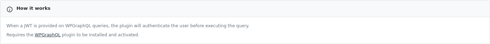

Keep the JWT endpoints reachable when Force Login restricts your WordPress REST API.

Requires the [Force Login](https://wordpress.org/plugins/force-login/) plugin (or a similar plugin that restricts REST API access to authenticated users only).

## What it does

The Force Login plugin redirects unauthenticated users away from your site and can lock down the REST API. Enabling this integration **exempts all Simple JWT Login endpoints** from that restriction.

This is necessary because unauthenticated clients need to reach the login, register, and token endpoints to authenticate in the first place - they cannot provide a WordPress session cookie before they have logged in.

## Enable

Toggle **Enable Force Login integration** to allow unauthenticated access to Simple JWT Login REST routes even when Force Login is active.

:::caution
This integration only bypasses the Force Login restriction for Simple JWT Login's own endpoints. All other WordPress REST endpoints remain subject to the Force Login rules.
:::

Since version 4.1.0, the bypass applies only to anonymous requests blocked by Force Login. It never skips WordPress's own checks for logged-in users, so cookie-authenticated requests still need a valid REST nonce (CSRF protection), and errors raised by other plugins are left untouched.
