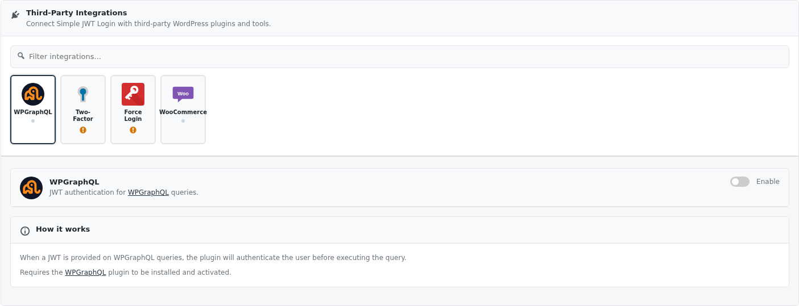

Simple JWT Login integrates with five third-party WordPress plugins and APIs - **WPGraphQL**, **Two-Factor**, **Force Login**, **WooCommerce**, and **AI Abilities (MCP)**.

Configure these under **Settings → Simple JWT Login → Integrations → Third Party Integrations**.

