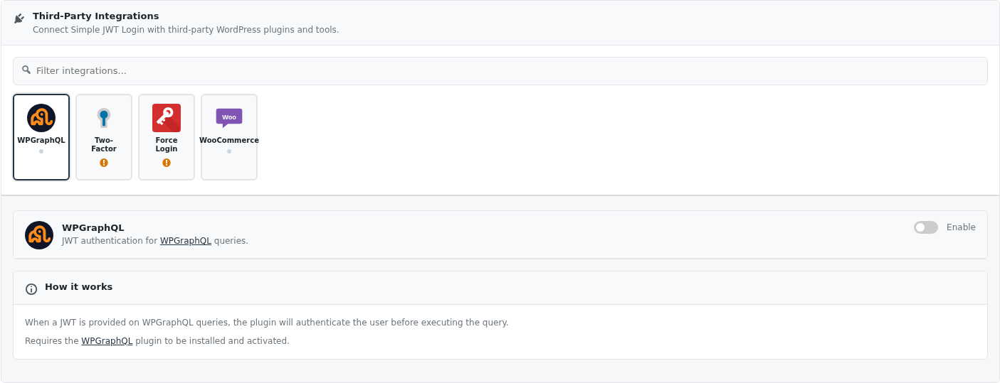

# WordPress JWT Plugin Integrations

Simple JWT Login integrates with five third-party WordPress plugins and APIs - [WPGraphQL](/docs/integrations/third-party/wpgraphql.md), [Two-Factor](/docs/integrations/third-party/two-factor.md), [Force Login](/docs/integrations/third-party/force-login.md), [WooCommerce](/docs/integrations/third-party/woocommerce.md), and [AI Abilities (MCP)](/docs/integrations/third-party/ai-abilities.md).

Configure these under **Settings → Simple JWT Login → Integrations → Third Party Integrations**.

